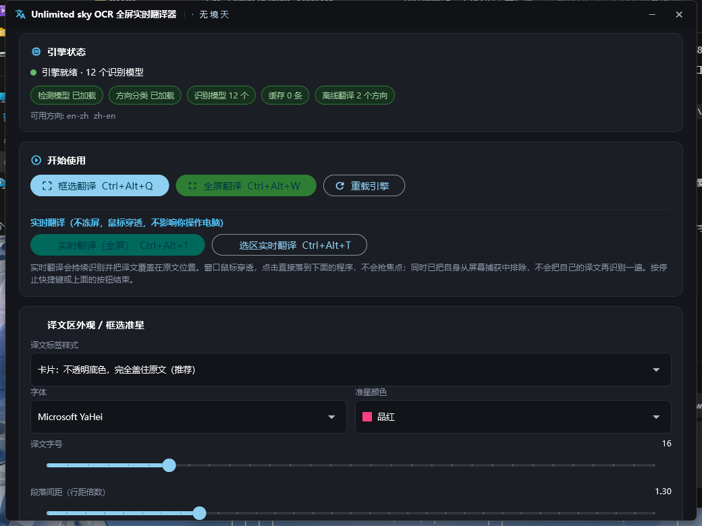
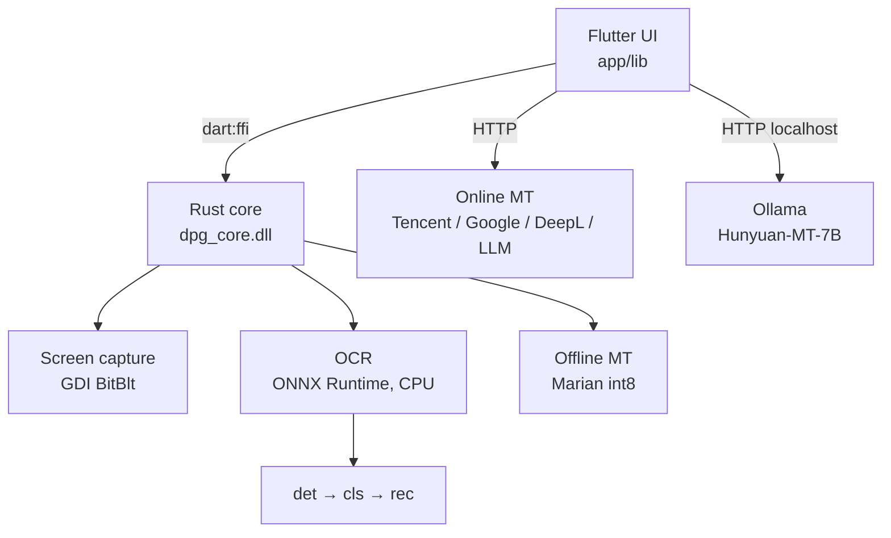

<div align="center">


# Unlimited Sky OCR

**Real-time full-screen OCR translation overlay for Windows.**
Frame any part of the screen and the translation is painted exactly on top of the original — no window switching, no copy-paste.

[](#requirements)
[](https://flutter.dev)
[](https://www.rust-lang.org)
[](LICENSE)
[](#supported-languages)

**English** · [简体中文](README.zh-CN.md)



</div>

---

## What it does

Point it at anything on screen. It captures the pixels, runs OCR on-device, translates the text, and draws the translation **in place** over the original — inside a click-through overlay that never steals focus.

```
┌─────────────────────────────────────────────────────────┐
│  Original screen content                                │
│  ┌───────────────────────────────────┐                  │
│  │  設定を変更すると再起動が必要です   │   ← OCR reads   │
│  └───────────────────────────────────┘                  │
│              ↓  on-device OCR + translate               │
│  ┌───────────────────────────────────┐                  │
│  │  更改设置后需要重新启动             │   ← painted on  │
│  └───────────────────────────────────┘      top         │
└─────────────────────────────────────────────────────────┘
```

---

## Features

### Capture & overlay
- **Three modes** — region select, full screen, or live realtime
- **Frameless fullscreen overlay** that genuinely reaches every screen edge
- **Click-through** in realtime mode: mouse input passes to whatever is underneath, so you keep working
- **Excluded from screen capture** (`WDA_EXCLUDEFROMCAPTURE`) so it never re-reads its own translation and loops
- **Left-click a label** to toggle original ↔ translation; **right-click** for a copy menu

### OCR
- **12 recognition models** — PP-OCRv5 mobile (detection + angle classification + recognition)
- **Per-line language detection**, so mixed Chinese/English/Japanese on one screen works
- **Lazy model loading** — only the language you actually use is read into memory
- **Crop content cache** — unchanged text regions skip the model entirely
- **Adjustable noise filter** (off / loose / standard / strict) to trade missing text against junk

### Translation
- **Offline fallback** — bundled Marian/OPUS-MT int8 models (EN↔ZH), works with no network
- **Online providers** — Tencent, Google, DeepL, or any OpenAI-compatible LLM
- **Local LLM** — one-click deployment of Tencent Hunyuan-MT-7B via Ollama (see [Local AI](#local-ai-optional))
- **Streaming output** — translation appears line by line instead of after a long blank wait
- **LRU cache + deduplication** — identical lines are translated once

### UX
- **System tray** with *Show window* / *Quit*
- **9 global hotkeys**, all rebindable by simply pressing the combination
- **Auto-start on boot** — self-healing if you move the install folder
- **Appearance controls** — font, size, line spacing, letter spacing, label opacity 0–100 %, crosshair style
- **Installer with hardware detection** for the optional local AI, with a clear explanation when your machine doesn't qualify

---

## Performance

Measured on a Ryzen 7 7700 + RTX 5060 at 2560×1440:

| Stage | Time | Notes |
|---|---|---|
| Engine load | **185 ms** | was 1079 ms before lazy loading |
| Process start → window | **~1.5 s** | mostly Flutter engine init |
| Idle memory | **~260 MB** | |
| Text detection | **~60 ms** | full screen, 39 lines |
| Angle classification | **~24 ms** | |
| Text recognition | **~1000 ms** | **92 % of scan time** — scales with pixel area, not line count |
| Recognition (cache hit) | **~40 ms** | when on-screen text is unchanged |
| Realtime tick (no change) | **23–40 ms** | frame diff + text-region mask |

> **Why recognition dominates:** it accounts for over 90 % of a full scan, and
> batch size, input width and thread count barely move the needle — the cost
> tracks total pixel area. The real win is not re-recognizing what hasn't
> changed, which is what the crop cache does.
>
> The other effective knob is **minimum text height**: dropping it to 24 px cuts
> a full-screen scan from 1503 ms to 404 ms (3.7×), at the cost of ignoring text
> too small to read anyway. Details in [development notes](docs/DEVELOPMENT-NOTES.md).

### Local AI translation

Optional, runs entirely on your GPU via Ollama:

| | |
|---|---|
| Model | Tencent Hunyuan-MT-7B, Q4_K_M (4.4 GB) |
| Speed | **~62 tokens/sec**, **100 % on GPU** |
| First line visible | **0.75 s** (streaming) |
| 4 UI lines | ~0.8 s |
| 60-line full screen | ~17 s |
| Quality | WMT25 — **1st place in 30 of 31 language pairs** |

---

## Requirements

### To run the prebuilt installer

| | Minimum | Recommended |
|---|---|---|
| OS | Windows 10 1809 (x64) | Windows 11 |
| RAM | 8 GB | 16 GB |
| Disk | 1 GB (app only) | 8 GB (with local AI) |
| GPU | — | Only needed for the optional local AI |

OCR and offline translation run on **CPU** — no GPU required.

### To use the optional local AI translation

| | Minimum | Recommended |
|---|---|---|
| GPU | NVIDIA, 6 GB VRAM | NVIDIA, 8 GB+ (RTX 3060 / 4060 / 5060 or better) |
| RAM | 16 GB | 16 GB+ |
| Disk | 12 GB free | 12 GB free |

The installer probes your hardware, tells you which quantisation level it will
use, or disables the option with a written explanation if you don't meet the bar.

### To build from source

- **Rust** 1.99+ (MSVC toolchain)
- **Flutter** 3.47+
- **Visual Studio Build Tools** with the C++ desktop workload and a Windows SDK
- **ONNX Runtime** 1.31.0 (see [Resource setup](#resource-setup))

---

## Quick start

### Option A — use the installer

1. Download the installer from [Releases](../../releases)
2. Run it; optionally tick **Install local AI translation** (extra ~6 GB download)
3. Launch from the desktop shortcut

### Option B — build from source

```powershell
git clone https://github.com/<your-name>/unlimited-sky-ocr.git
cd unlimited-sky-ocr

# 1. put ONNX Runtime and the OCR models into runtime/ and models/
powershell -File tools\fetch_resources.ps1

# 2. build the Rust core -> dpg_core.dll
cd core
cargo build --release

# 3. build the Flutter app
cd ..\app
flutter pub get
flutter build windows --release

# output: app\build\windows\x64\runner\Release\UnlimitedSky.exe
```

Or run all three steps with one wrapper:

```powershell
powershell -File tools\build_windows.ps1
```

---

## Resource setup

The repository **does not** contain model files or the ONNX Runtime binary —
they're large. You need:

| Resource | Where to get it | Destination |
|---|---|---|
| ONNX Runtime 1.31.0 (win-x64) | [GitHub releases](https://github.com/microsoft/onnxruntime/releases) | `runtime/bin/onnxruntime.dll` |
| PP-OCRv5 OCR models | [RapidAI/RapidOCR](https://github.com/RapidAI/RapidOCR) or [ModelScope](https://www.modelscope.cn/models/RapidAI/RapidOCR) | `models/ocr/` |
| OPUS-MT EN↔ZH int8 (optional) | [Xenova/opus-mt-*](https://huggingface.co/Xenova) | `models/translate/` |

Expected layout:

```
models/
├── ocr/
│   ├── det/ch_PP-OCRv5_det_mobile.onnx
│   ├── cls/ch_PP-LCNet_x0_25_textline_ori_cls_mobile.onnx
│   └── rec/{ch,en,korean,cyrillic,latin,arabic,...}_rec_mobile.onnx
└── translate/
    ├── en-zh/
    └── zh-en/

runtime/bin/onnxruntime.dll
```

> PP-OCRv5 ships **no dedicated Japanese recognition model**. The `ch` model's
> dictionary contains full hiragana and katakana and scores 0.99+ on Japanese
> text, so the app maps Japanese to the `ch` model. See
> [`app/lib/core/models.dart`](app/lib/core/models.dart).

---

## Usage

| Hotkey | Action |
|---|---|
| `Ctrl+Alt+Q` | Region select → translate |
| `Ctrl+Alt+W` | Full screen → translate (press again to close) |
| `Ctrl+Alt+1` | Toggle realtime translation |
| `Ctrl+Alt+T` | Realtime on a selected region |
| `Ctrl+Alt+N` | Force a full rescan (realtime) |
| `Ctrl+Alt+H` | Freeze and interact with the translations |
| `Ctrl+Alt+V` | Temporarily restore mouse input |
| `Ctrl+Alt+G` | Exit realtime → main panel |
| `Ctrl+Alt+P` | Open the main panel |

Every hotkey is rebindable in the app: click a field and press the combination.
Conflicts with other software are detected and flagged in red.

### Supported languages

**OCR (12 models):** Chinese (simplified/traditional), Japanese, English, Korean,
Russian, Latin-script (French/German/Spanish/…), Arabic, Devanagari, Greek,
East Slavic (Ukrainian/…), Thai, Tamil, Telugu.

**Translation targets:** Simplified Chinese, Traditional Chinese, English,
Japanese, Korean, Russian, French, German, Spanish, Portuguese, Italian,
Arabic, Thai.

> **Tip:** auto-detection uses the Chinese model as a base and retries
> low-confidence lines with other models. For Korean, Russian and similar
> scripts it is noticeably more accurate to pick the language explicitly.

---

## Local AI (optional)

For high-quality offline translation the installer can set up
**Tencent Hunyuan-MT-7B** running locally through [Ollama](https://ollama.com):

1. It picks a quantisation level from your VRAM (Q5_K_M / Q4_K_M / Q3_K_M)
2. Downloads Ollama (~1.5 GB) and the model (~4.4 GB)
3. Imports the model and runs a self-test
4. Records the paths in `ai_config.json`

At runtime the app:

- reads `OLLAMA_MODELS` from the registry so it knows where the models live
- **automatically restarts Ollama with the correct model directory** when it
  can't see the model — the tray build of Ollama drops that environment variable
  at login, which otherwise leaves you with *"Ollama is running but the model
  isn't found"* on every boot
- falls back to the bundled Marian models when Ollama is unreachable

You can also point the app at an existing model manually: the settings page has
browse buttons for the Ollama directory, the models directory and a `.gguf`
file, with a one-click **Import** button for the last one.

---

## Architecture



| Layer | Tech | Location |
|---|---|---|
| UI | Flutter (Dart) | [`app/`](app) |
| Inference core | Rust → C ABI DLL | [`core/`](core) |
| Installer | Rust, raw Win32 GUI | [`installer/`](installer) |
| Build scripts | PowerShell | [`tools/`](tools) |

**Why Rust + Dart?** The OCR pipeline (capture → detect → classify → recognize)
has to stay in the tens of milliseconds. Dart can't do FFI image processing that
predictably; Rust can, and the same core stays reusable on other platforms later.

### Interesting bits

- **Frame diff with a text-region mask** ([`frame_diff.dart`](app/lib/core/frame_diff.dart)) —
  an animated wallpaper changes pixels constantly but moves no text. Only changes
  overlapping known text boxes count, so realtime doesn't rescan the world every
  120 ms.
- **Single-flight realtime translation** — a generation counter discards stale
  *results*, but requests still pile up on the GPU. There's an explicit in-flight
  guard plus a text-fingerprint check, so unchanged text is never re-sent.
- **Crop content cache** ([`engine.rs`](core/src/engine.rs)) — FNV-1a hash over a
  sampled crop; a hit skips recognition entirely.
- **Single instance** — named mutex plus process enumeration; a second launch
  wakes the first one through a named event rather than trying to `ShowWindow`
  across processes, which is restricted and fails silently.
- **Capture exclusion** — `SetWindowDisplayAffinity(WDA_EXCLUDEFROMCAPTURE)` keeps
  the overlay out of its own screenshots.

---

## Configuration

Settings live in `shared_preferences` and can be edited from the app. Notable ones:

| Key | Default | Meaning |
|---|---|---|
| `ocrLang` | `auto` | OCR language; set explicitly for better accuracy |
| `targetLang` | `zh-CN` | Translation target |
| `provider` | `tencent` | Translation engine |
| `noiseLevel` | `1` | 0=off, 1=loose, 2=standard, 3=strict |
| `realtimeIntervalMs` | `120` | Frame check interval |
| `realtimeRescanMs` | `2000` | Forced full rescan interval (0 = never) |
| `labelOpacity` | `1.0` | 0 = text only, 1 = fully opaque background |
| `autoStart` | `false` | Launch at login (path self-repairs) |

Logs: `%LOCALAPPDATA%\UnlimitedSkyOCR\dpg.log`

---

## Troubleshooting

<details>
<summary><b>Startup feels slow</b></summary>

The window appears in ~1.5 s, most of which is Flutter engine initialisation.
Model loading itself is 185 ms, and nothing is loaded until it's needed.
</details>

<details>
<summary><b>Nothing is recognized / text is missing</b></summary>

The noise filter is probably too aggressive. Settings → **OCR noise level** →
try `off` or `loose`. The default (`loose`) only drops pure-symbol and
duplicate-character artifacts.
</details>

<details>
<summary><b>Recognition is inaccurate for Korean / Russian / etc.</b></summary>

Set the OCR language explicitly instead of using auto-detect. Auto mode builds on
the Chinese model, which is optimal for Chinese/English/Japanese but not for
other scripts.
</details>

<details>
<summary><b>"Ollama is running but the model isn't found"</b></summary>

The tray build of Ollama doesn't inherit `OLLAMA_MODELS` at login. The app
detects this and restarts Ollama with the right directory automatically. If it
still fails, use **Settings → Repair**, or point it at the model with the browse
buttons.
</details>

<details>
<summary><b>The app won't start — nothing happens on double-click</b></summary>

An earlier instance is probably still running in the tray; double-clicking wakes
it instead of starting a second copy. Look for the icon in the notification area
(Windows 11 hides new tray icons in the overflow — click the `^`).
</details>

<details>
<summary><b>Realtime mode spins the GPU but translation is slow</b></summary>

Fixed in recent versions. It was a request pile-up: every frame change fired a new
translation request without waiting for the previous one. Check the log for
`TimeoutException` — if there are none, you're on the fixed build.
</details>

---

## Roadmap

- [ ] Move recognition to the GPU (DirectML / CUDA) — currently CPU-only
- [ ] macOS build (the Rust core is already portable)
- [ ] More offline translation pairs
- [ ] Plugin API for custom translation providers

## Contributing

Issues and pull requests are welcome — see [CONTRIBUTING.md](CONTRIBUTING.md).
For bug reports, please attach `%LOCALAPPDATA%\UnlimitedSkyOCR\dpg.log`.

## License

Source code: [MIT](LICENSE).

Bundled models and third-party components carry their own licenses, and some are
**not** OSI-approved. **Read [THIRD_PARTY_NOTICES.md](THIRD_PARTY_NOTICES.md)
before distributing**, especially regarding Tencent Hunyuan-MT-7B.

## Acknowledgements

- [PaddleOCR](https://github.com/PaddlePaddle/PaddleOCR) and
  [RapidOCR](https://github.com/RapidAI/RapidOCR) — OCR models
- [ONNX Runtime](https://github.com/microsoft/onnxruntime) — inference
- [Ollama](https://ollama.com) and [llama.cpp](https://github.com/ggml-org/llama.cpp) — local LLM
- [Helsinki-NLP](https://huggingface.co/Helsinki-NLP) — OPUS-MT offline translation
- [Tencent Hunyuan](https://github.com/Tencent-Hunyuan/Hunyuan-MT) — Hunyuan-MT-7B
