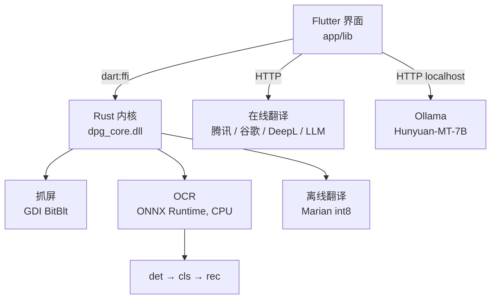

<div align="center">


# Unlimited Sky OCR

**Windows 全屏实时 OCR 翻译浮层。**
框住屏幕上任意区域，译文直接绘制在原文位置 —— 不用切窗口，不用复制粘贴。

[](#环境要求)
[](https://flutter.dev)
[](https://www.rust-lang.org)
[](LICENSE)
[](#支持的语言)

[English](README.md) · **简体中文**


</div>

---

## 它做什么

对准屏幕上任意位置，它抓取像素、在本机跑 OCR、翻译，然后把译文**原位覆盖**在原文上 —— 整个过程在一个鼠标穿透的浮层里完成，**永远不会抢走你的焦点**。

```
┌─────────────────────────────────────────────────────────┐
│  屏幕上的原始内容                                        │
│  ┌───────────────────────────────────┐                  │
│  │  設定を変更すると再起動が必要です   │   ← OCR 读到    │
│  └───────────────────────────────────┘                  │
│              ↓  本机 OCR + 翻译                          │
│  ┌───────────────────────────────────┐                  │
│  │  更改设置后需要重新启动             │   ← 覆盖绘制    │
│  └───────────────────────────────────┘                  │
└─────────────────────────────────────────────────────────┘
```

---

## 功能

### 抓屏与浮层
- **三种模式** —— 框选、全屏单次、实时翻译
- **无边框全屏浮层**，真正做到铺满到屏幕边缘，不留缝
- **实时模式鼠标穿透** —— 浮层对鼠标透明，你可以继续操作下面的程序
- **从屏幕捕获中排除自己**（`WDA_EXCLUDEFROMCAPTURE`），不会把自己的译文再识别一遍造成死循环
- **左键点标签**切换原文/译文，**右键**出复制菜单

### OCR
- **12 个识别模型**，PP-OCRv5 mobile（检测 + 方向分类 + 识别）
- **逐行判定语言** —— 同一屏中英日混排也能正确处理
- **模型按需加载** —— 只把你实际用到的语种读进内存
- **裁剪内容缓存** —— 没变过的文字区域直接跳过模型推理
- **可调降噪强度**（关闭 / 宽松 / 标准 / 严格），自己权衡"漏内容"和"夹垃圾"

### 翻译
- **离线兜底** —— 内置 Marian/OPUS-MT int8 模型（中↔英），断网也能用
- **在线服务** —— 腾讯、谷歌、DeepL，或任何 OpenAI 兼容大模型
- **本地大模型** —— 一键部署腾讯混元 Hunyuan-MT-7B（见 [本地 AI](#本地-ai可选)）
- **流式输出** —— 译文逐行冒出来，而不是干等一大段空白
- **LRU 缓存 + 去重** —— 重复的行只翻一次

### 使用体验
- **系统托盘**，带「显示主界面 / 退出」
- **9 个全局热键**，全部可以点一下然后直接按组合键改绑
- **开机自启** —— 程序被移动过也能自动修正路径
- **外观可调** —— 字体、字号、行距、字间距、标签不透明度 0–100%、准星样式
- **安装程序带硬件检测**，本地 AI 装不装得了会明确告诉你

---

## 性能

实测环境：Ryzen 7 7700 + RTX 5060，2560×1440

| 阶段 | 耗时 | 说明 |
|---|---|---|
| 引擎加载 | **185 ms** | 按需加载前是 1079 ms |
| 进程启动 → 窗口出现 | **约 1.5 s** | 大头是 Flutter 引擎初始化 |
| 空闲内存 | **约 260 MB** | |
| 文本检测 det | **约 60 ms** | 全屏 39 行 |
| 方向分类 cls | **约 24 ms** | |
| 文本识别 rec | **约 1000 ms** | **占整屏扫描 92%**，按像素面积算，不按行数 |
| 识别（命中缓存） | **约 40 ms** | 屏幕文字没变时 |
| 实时轮次（无变化） | **23–40 ms** | 帧差 + 文字区域掩码 |

> **为什么瓶颈在识别**：它占整屏扫描 90% 以上。批大小、输入宽度、线程数
> 几乎都无影响 —— 成本跟着**总像素面积**走。真正的解法是**不重复识别没变的
> 东西**，也就是裁剪内容缓存做的事。
>
> 另一个有效开关是**「最小文本高度」**：调到 24px 后全屏扫描从 1503 ms 降到
> 404 ms（3.7×），代价是放弃屏幕上人眼也读不清的极小文字。详见
> [开发笔记](docs/DEVELOPMENT-NOTES.md)。

### 本地 AI 翻译

可选，完全跑在你的显卡上（通过 Ollama）：

| | |
|---|---|
| 模型 | 腾讯混元 Hunyuan-MT-7B，Q4_K_M（4.4 GB） |
| 速度 | **约 62 tokens/秒**，**100% 在 GPU 上** |
| 首行出现 | **0.75 秒**（流式） |
| 4 行界面文字 | 约 0.8 秒 |
| 60 行整屏 | 约 17 秒 |
| 质量 | WMT25 比赛 31 个语向里拿了 **30 个第一** |

---

## 环境要求

### 运行现成安装包

| | 最低 | 推荐 |
|---|---|---|
| 系统 | Windows 10 1809 (x64) | Windows 11 |
| 内存 | 8 GB | 16 GB |
| 磁盘 | 1 GB（仅程序） | 8 GB（含本地 AI） |
| 显卡 | —— | 只有可选的本地 AI 需要 |

OCR 和离线翻译都跑在 **CPU** 上，**不需要显卡**。

### 使用可选的本地 AI 翻译

| | 最低 | 推荐 |
|---|---|---|
| 显卡 | NVIDIA，6 GB 显存 | NVIDIA，8 GB+（RTX 3060 / 4060 / 5060 及以上） |
| 内存 | 16 GB | 16 GB+ |
| 磁盘 | 12 GB 可用 | 12 GB 可用 |

安装程序会自动检测硬件，告诉你将使用哪一档量化，或者在不达标时**明确说明原因并禁用该选项**。

### 从源码构建

- **Rust** 1.99+（MSVC 工具链）
- **Flutter** 3.47+
- **Visual Studio Build Tools**（含 C++ 桌面开发负载 + Windows SDK）
- **ONNX Runtime** 1.31.0（见[资源准备](#资源准备)）

---

## 快速开始

### 方式一 —— 用安装程序

1. 从 [Releases](../../releases) 下载安装包
2. 运行，可选勾选「**一起安装本地 AI 翻译**」（额外下载约 6 GB）
3. 从桌面快捷方式启动

### 方式二 —— 从源码构建

```powershell
git clone https://github.com/<你的用户名>/unlimited-sky-ocr.git
cd unlimited-sky-ocr

# 1. 把 ONNX Runtime 和 OCR 模型放到 runtime/ 和 models/
powershell -File tools\fetch_resources.ps1

# 2. 编译 Rust 内核 -> dpg_core.dll
cd core
cargo build --release

# 3. 编译 Flutter 界面
cd ..\app
flutter pub get
flutter build windows --release

# 产物: app\build\windows\x64\runner\Release\UnlimitedSky.exe
```

或者一条命令跑完三步：

```powershell
powershell -File tools\build_windows.ps1
```

---

## 资源准备

仓库里**不包含**模型文件和 ONNX Runtime 二进制（体积太大）。你需要：

| 资源 | 从哪来 | 放到哪 |
|---|---|---|
| ONNX Runtime 1.31.0 (win-x64) | [GitHub releases](https://github.com/microsoft/onnxruntime/releases) | `runtime/bin/onnxruntime.dll` |
| PP-OCRv5 OCR 模型 | [RapidAI/RapidOCR](https://github.com/RapidAI/RapidOCR) 或 [ModelScope](https://www.modelscope.cn/models/RapidAI/RapidOCR) | `models/ocr/` |
| OPUS-MT 中英 int8（可选） | [Xenova/opus-mt-*](https://huggingface.co/Xenova) | `models/translate/` |

期望的目录结构：

```
models/
├── ocr/
│   ├── det/ch_PP-OCRv5_det_mobile.onnx
│   ├── cls/ch_PP-LCNet_x0_25_textline_ori_cls_mobile.onnx
│   └── rec/{ch,en,korean,cyrillic,latin,arabic,...}_rec_mobile.onnx
└── translate/
    ├── en-zh/
    └── zh-en/

runtime/bin/onnxruntime.dll
```

> PP-OCRv5 里**没有专门的日语识别模型**。但 `ch` 模型的字典里含完整平假名和
> 片假名，实测日语识别置信度 0.99 以上 —— 所以程序把日语映射到 `ch` 模型。
> 见 [`app/lib/core/models.dart`](app/lib/core/models.dart)。

---

## 使用

| 热键 | 作用 |
|---|---|
| `Ctrl+Alt+Q` | 框选翻译 |
| `Ctrl+Alt+W` | 全屏翻译（再按一次关闭） |
| `Ctrl+Alt+1` | 开启/关闭实时翻译 |
| `Ctrl+Alt+T` | 选区实时翻译 |
| `Ctrl+Alt+N` | 强制重扫整屏（实时模式） |
| `Ctrl+Alt+H` | 冻结画面并操控译文 |
| `Ctrl+Alt+V` | 临时恢复鼠标点击 |
| `Ctrl+Alt+G` | 退出实时翻译回主界面 |
| `Ctrl+Alt+P` | 打开主界面 |

所有热键都能在软件里改绑：点一下方框，直接按你想要的组合键。和其它软件冲突会被检测出来标红。

### 支持的语言

**OCR（12 个模型）**：中文（简/繁）、日语、英语、韩语、俄语、拉丁语系（法/德/西等）、
阿拉伯语、天城文、希腊语、东斯拉夫语（乌克兰语等）、泰语、泰米尔语、泰卢固语。

**翻译目标**：简体中文、繁体中文、英语、日语、韩语、俄语、法语、德语、西班牙语、
葡萄牙语、意大利语、阿拉伯语、泰语。

> **提示**：自动检测是用中文模型打底、再对低置信行换模型重试。韩语、俄语这类
> **手动指定语种会明显更准**。

---

## 本地 AI（可选）

想要高质量的离线翻译，安装程序可以帮你装好本地运行的
**腾讯混元 Hunyuan-MT-7B**（通过 [Ollama](https://ollama.com)）：

1. 按你的显存自动选量化档（Q5_K_M / Q4_K_M / Q3_K_M）
2. 下载 Ollama（约 1.5 GB）和模型（约 4.4 GB）
3. 导入模型并自检
4. 把路径记到 `ai_config.json`

运行时程序会：
- 从注册表读 `OLLAMA_MODELS`，知道模型放在哪
- **发现模型看不到时，自动用正确的模型目录重启 Ollama** —— 托盘版 Ollama
  开机自启时会丢掉这个环境变量，否则你每次开机都会遇到
  「Ollama 在跑但没找到模型」
- Ollama 连不上时回退到内置的 Marian 离线模型

你也可以手动指定已有的模型：设置页有「Ollama 程序目录 / 模型存放目录 /
模型文件(.gguf)」三个浏览按钮，`.gguf` 那个还配了「导入模型」一键导入。

---

## 架构



| 层 | 技术 | 位置 |
|---|---|---|
| 界面 | Flutter (Dart) | [`app/`](app) |
| 推理内核 | Rust → C ABI DLL | [`core/`](core) |
| 安装程序 | Rust + 原生 Win32 GUI | [`installer/`](installer) |
| 构建脚本 | PowerShell | [`tools/`](tools) |

**为什么用 Rust + Dart？** OCR 流水线（抓屏 → 检测 → 分类 → 识别）必须压在
几十毫秒级。Dart 用 FFI 做图像处理做不到这个稳定性，Rust 可以，而且同一份
内核以后能复用到别的平台。

### 几个值得一提的实现

- **带文字区域掩码的帧差**（[`frame_diff.dart`](app/lib/core/frame_diff.dart)）——
  动态壁纸会不停改像素但一个字的没动。只有落在已知文字框范围内的变化才算数，
  否则实时模式会每 120ms 重扫整个世界。
- **实时翻译单飞** —— 代数计数器只能丢弃过期的**结果**，请求本身还是会堆在
  显卡上。所以额外加了"同一时刻只允许一个请求在飞"+ 文本指纹去重。
- **裁剪内容缓存**（[`engine.rs`](core/src/engine.rs)）—— 对采样后的裁剪图算
  FNV-1a 哈希，命中就完全跳过识别。
- **单实例** —— 命名互斥体 + 进程枚举双保险；第二次启动通过命名事件唤醒已有
  实例，而不是跨进程去 `ShowWindow`（那受前台窗口权限限制，经常静默失败）。
- **捕获排除** —— `SetWindowDisplayAffinity(WDA_EXCLUDEFROMCAPTURE)`，保证浮层
  不会出现在自己的截图里。

---

## 配置

设置存在 `shared_preferences` 里，也可以在界面上改。几个关键的：

| 键 | 默认 | 含义 |
|---|---|---|
| `ocrLang` | `auto` | 识别语言；指定语种准确率更高 |
| `targetLang` | `zh-CN` | 翻译目标 |
| `provider` | `tencent` | 翻译引擎 |
| `noiseLevel` | `1` | 0=关闭 1=宽松 2=标准 3=严格 |
| `realtimeIntervalMs` | `120` | 画面变化检测间隔 |
| `realtimeRescanMs` | `2000` | 强制重扫间隔（0 = 从不） |
| `labelOpacity` | `1.0` | 0 = 只剩文字，1 = 完全不透明底 |
| `autoStart` | `false` | 开机自启（路径会自动修正） |

日志：`%LOCALAPPDATA%\UnlimitedSkyOCR\dpg.log`

---

## 常见问题

<details>
<summary><b>启动感觉有点慢</b></summary>

窗口约 1.5 秒出现，大头是 Flutter 引擎初始化。模型加载本身只要 185ms，
而且是**用到才加载**。
</details>

<details>
<summary><b>很多内容识别不出来</b></summary>

多半是降噪太狠了。到设置里把「**OCR 降噪强度**」调成 `关闭` 或 `宽松` 试试。
默认的「宽松」只丢弃纯符号和重复字符。
</details>

<details>
<summary><b>韩语 / 俄语识别不准</b></summary>

别用「自动检测」，直接在设置里指定语种。自动模式用中文模型打底，
对中英日最优，对其它文种不是。
</details>

<details>
<summary><b>提示「Ollama 在跑，但没找到模型」</b></summary>

托盘版 Ollama 开机自启时不会继承 `OLLAMA_MODELS`。程序会检测到并**自动用
正确的模型目录把它重启**。如果还不行，点设置里的「一键修复」，或者用浏览
按钮手动指定模型位置。
</details>

<details>
<summary><b>双击没反应，程序打不开</b></summary>

多半是已经有一个实例在托盘里跑着。再双击会唤醒它而不是开第二个。去通知区
找图标（Windows 11 默认会把新图标收进折叠区，点任务栏的 `^`）。
</details>

<details>
<summary><b>实时翻译时显卡狂跑但翻译很慢</b></summary>

老版本的问题，已修复。原因是**翻译请求无限堆积**：画面一变就发新请求，
不等上一个完成。看日志里有没有 `TimeoutException` —— 一条都没有说明你用的是
修复后的版本。
</details>

---

## 后续计划

- [ ] 把识别挪到 GPU（DirectML / CUDA）—— 目前是纯 CPU
- [ ] macOS 版本（Rust 内核本身是可移植的）
- [ ] 更多离线翻译语言对
- [ ] 自定义翻译服务的插件接口

## 参与

欢迎提 Issue 和 PR，见 [CONTRIBUTING.md](CONTRIBUTING.md)。
反馈问题时请附上 `%LOCALAPPDATA%\UnlimitedSkyOCR\dpg.log`。

## 许可证

源代码：[MIT](LICENSE)。

随附的模型和第三方组件各有各的许可证，**部分并非 OSI 认可的开源许可证**。
**分发前请务必阅读 [THIRD_PARTY_NOTICES.md](THIRD_PARTY_NOTICES.md)**，
尤其是腾讯混元 Hunyuan-MT-7B 那一条。

## 致谢

- [PaddleOCR](https://github.com/PaddlePaddle/PaddleOCR) 与
  [RapidOCR](https://github.com/RapidAI/RapidOCR) —— OCR 模型
- [ONNX Runtime](https://github.com/microsoft/onnxruntime) —— 推理
- [Ollama](https://ollama.com) 与 [llama.cpp](https://github.com/ggml-org/llama.cpp) —— 本地大模型
- [Helsinki-NLP](https://huggingface.co/Helsinki-NLP) —— OPUS-MT 离线翻译
- [腾讯混元](https://github.com/Tencent-Hunyuan/Hunyuan-MT) —— Hunyuan-MT-7B
